<!--
  Profile README for github.com/medwinjose
  Static images live in /assets and are generated by: python scripts/build_assets.py
  The contribution city (assets/city-*.svg) is rebuilt every few minutes by
  .github/workflows/city.yml from the contribution calendar.
  Spacing is built into the images (every section opener carries the same
  space above it), so blocks below are separated by single blank lines only.
-->

<picture>
  <source media="(prefers-color-scheme: dark)" srcset="assets/header-dark.svg">
  
</picture>

<a href="https://www.linkedin.com/in/medwinjose/"><picture><source media="(prefers-color-scheme: dark)" srcset="assets/link-linkedin-dark.svg"></picture></a>&nbsp;<a href="https://orcid.org/0009-0004-6715-8491"><picture><source media="(prefers-color-scheme: dark)" srcset="assets/link-orcid-dark.svg"></picture></a>&nbsp;<a href="https://scholar.google.com/citations?user=fc0lGIEAAAAJ"><picture><source media="(prefers-color-scheme: dark)" srcset="assets/link-scholar-dark.svg"></picture></a>&nbsp;<a href="mailto:medwinjose@gmail.com"><picture><source media="(prefers-color-scheme: dark)" srcset="assets/link-email-dark.svg"></picture></a>

<picture>
  <source media="(prefers-color-scheme: dark)" srcset="assets/section-about-dark.svg">
  
</picture>

I study and build <b>systems that stay correct when some of their participants misbehave</b>: networks where peers lie, markets where traders game the order book, and pipelines where one bad input should never take everything down. My work sits where distributed systems meet security, and most of it is written in Rust.

I like the unglamorous parts of engineering: specifying behaviour before writing code, testing properties instead of examples, and publishing every number with the command that produced it.

<b>Research interests</b> &nbsp;·&nbsp; distributed systems &nbsp;·&nbsp; formal methods &nbsp;·&nbsp; security 

<picture>
  <source media="(prefers-color-scheme: dark)" srcset="assets/section-instruments-dark.svg">
  
</picture>

<picture>
  <source media="(prefers-color-scheme: dark)" srcset="assets/instruments-dark.svg">
  
</picture>

<picture>
  <source media="(prefers-color-scheme: dark)" srcset="assets/section-work-dark.svg">
  
</picture>

<a href="https://github.com/medwinjose/crci"><picture><source media="(prefers-color-scheme: dark)" srcset="assets/card-crci-dark.svg"></picture></a><a href="https://github.com/medwinjose/sentinel"><picture><source media="(prefers-color-scheme: dark)" srcset="assets/card-sentinel-dark.svg"></picture></a>

<b>CRCI</b> &nbsp;·&nbsp; preprint <a href="https://doi.org/10.5281/zenodo.23032042">doi:10.5281/zenodo.23032042</a> 
<b>SENTINEL</b> &nbsp;·&nbsp; <a href="https://github.com/medwinjose/sentinel/blob/master/engine/benches/results/sweep_results.csv">500-seed results</a>, produced by <code>cargo test --release -p sentinel-agents --test ecology_stats</code>

<picture>
  <source media="(prefers-color-scheme: dark)" srcset="assets/section-city-dark.svg">
  
</picture>

<picture>
  <source media="(prefers-color-scheme: dark)" srcset="assets/city-dark.svg">
  
</picture>

<i>Each building is one day; its height is that day's contributions. Rebuilt every few minutes from my GitHub activity.</i>

<picture>
  <source media="(prefers-color-scheme: dark)" srcset="assets/footer-dark.svg">
  
</picture>

