<!--
  Profile README for github.com/medwinjose
  Every image lives in /assets and is generated by /scripts:
    python scripts/build_assets.py   → masthead, sections, cards, instruments, record, footer
    python scripts/city.py           → contribution city (also rebuilt nightly by .github/workflows/city.yml)
-->

<picture>
  <source media="(prefers-color-scheme: dark)" srcset="assets/header-dark.svg">
  
</picture>

<picture>
  <source media="(prefers-color-scheme: dark)" srcset="assets/status-dark.svg">
  
</picture>

<a href="https://doi.org/10.5281/zenodo.23032042"><picture><source media="(prefers-color-scheme: dark)" srcset="assets/link-preprint-dark.svg"></picture></a>&nbsp;<a href="https://www.linkedin.com/in/medwinjose/"><picture><source media="(prefers-color-scheme: dark)" srcset="assets/link-linkedin-dark.svg"></picture></a>&nbsp;<a href="https://traceflux.vercel.app/"><picture><source media="(prefers-color-scheme: dark)" srcset="assets/link-demo-dark.svg"></picture></a>

 

<picture>
  <source media="(prefers-color-scheme: dark)" srcset="assets/section-about-dark.svg">
  
</picture>

I study and build <b>systems that stay correct when some of their participants misbehave</b>. I am an undergraduate in Computer Science &amp; Engineering at VIT Bhopal University (2024 – 2028), and one question runs through everything below. In a disaster-zone mesh network, the misbehaving participant is a peer replaying stale alerts. In an electronic market, it is a spoofer distorting the order book. In a payment network, it is a chain of mule accounts moving stolen money faster than banks can talk to each other.

I work as an engineer first: Rust where latency and memory safety matter, TLA+ and property-based tests where correctness has to be argued rather than assumed, and benchmarks published with raw data and exact commands so that anyone can check a number. When a result does not hold up, as with SENTINEL's ablation at 95% confidence, the README says so. Before software, I was a founding member and team manager of Team Vortex, which placed 16th in the world at SAE Aero Design West in Fort Worth, Texas.

 

R E S E A R C H &nbsp; I N T E R E S T S 
<i>Fault-tolerant distributed systems &nbsp;·&nbsp; formal methods &nbsp;·&nbsp; adversarial markets &nbsp;·&nbsp; financial networks</i>

 

<picture>
  <source media="(prefers-color-scheme: dark)" srcset="assets/section-work-dark.svg">
  
</picture>

<a href="https://github.com/medwinjose/crci"><picture><source media="(prefers-color-scheme: dark)" srcset="assets/card-crci-dark.svg"></picture></a><a href="https://github.com/medwinjose/sentinel"><picture><source media="(prefers-color-scheme: dark)" srcset="assets/card-sentinel-dark.svg"></picture></a>
<a href="https://github.com/medwinjose/TraceFlux"><picture><source media="(prefers-color-scheme: dark)" srcset="assets/card-traceflux-dark.svg"></picture></a><a href="https://github.com/medwinjose/Inkgauge"><picture><source media="(prefers-color-scheme: dark)" srcset="assets/card-inkgauge-dark.svg"></picture></a>

Also: <a href="https://github.com/medwinjose/gmail-ai-crm"><b>InboxIQ</b></a>, which builds a structured contact database from Gmail using Claude and OAuth2.

  

<picture>
  <source media="(prefers-color-scheme: dark)" srcset="assets/section-instruments-dark.svg">
  
</picture>

<picture>
  <source media="(prefers-color-scheme: dark)" srcset="assets/instruments-dark.svg">
  
</picture>

  

<picture>
  <source media="(prefers-color-scheme: dark)" srcset="assets/section-record-dark.svg">
  
</picture>

<picture>
  <source media="(prefers-color-scheme: dark)" srcset="assets/record-dark.svg">
  
</picture>

P R E P R I N T 
<b>CRCI: Local Reputation-Based Fault Isolation for Ad-Hoc Gossip Communication</b> 
<i>Medwin Jose · Vellore Institute of Technology, Bhopal · Zenodo</i> 
<a href="https://doi.org/10.5281/zenodo.23032042">doi:10.5281/zenodo.23032042</a> &nbsp;·&nbsp; software archive <a href="https://doi.org/10.5281/zenodo.23033990">doi:10.5281/zenodo.23033990</a>

  

<picture>
  <source media="(prefers-color-scheme: dark)" srcset="assets/section-city-dark.svg">
  
</picture>

<picture>
  <source media="(prefers-color-scheme: dark)" srcset="assets/city-dark.svg">
  
</picture>

<i>Each building is one day; its height is that day's contributions. Rebuilt nightly by a script in this repository.</i>

  

<picture>
  <source media="(prefers-color-scheme: dark)" srcset="assets/footer-dark.svg">
  
</picture>

