<!--
  Profile README for github.com/medwinjose
  Static images live in /assets and are generated by: python scripts/build_assets.py
  The contribution city is rebuilt every hour by .github/workflows/city.yml
  and published to the `output` branch.
-->

<picture>
  <source media="(prefers-color-scheme: dark)" srcset="assets/header-dark.svg">
  
</picture>

<a href="https://www.linkedin.com/in/medwinjose/"><picture><source media="(prefers-color-scheme: dark)" srcset="assets/link-linkedin-dark.svg"></picture></a>

 

<picture>
  <source media="(prefers-color-scheme: dark)" srcset="assets/section-about-dark.svg">
  
</picture>

I study and build <b>systems that stay correct when some of their participants misbehave</b>: networks where peers lie, markets where traders try to game the order book, and pipelines where one bad input should never bring the whole thing down. Most of my work sits where distributed systems meet security, and most of it is written in Rust.

I like the unglamorous parts of engineering: specifying behaviour before writing code, testing properties instead of examples, and publishing every number alongside the command that produced it. If a result doesn't hold up, I would rather say so than round it up. Before software I built aircraft, which taught me that a system is only as good as its least-tested part.

 

R E S E A R C H &nbsp; I N T E R E S T S 
<i>Fault-tolerant distributed systems &nbsp;·&nbsp; formal methods &nbsp;·&nbsp; adversarial robustness &nbsp;·&nbsp; security</i>

 

<picture>
  <source media="(prefers-color-scheme: dark)" srcset="assets/section-instruments-dark.svg">
  
</picture>

<picture>
  <source media="(prefers-color-scheme: dark)" srcset="assets/instruments-dark.svg">
  
</picture>

  

<picture>
  <source media="(prefers-color-scheme: dark)" srcset="assets/section-city-dark.svg">
  
</picture>

<picture>
  <source media="(prefers-color-scheme: dark)" srcset="https://raw.githubusercontent.com/medwinjose/medwinjose/output/city-dark.svg">
  
</picture>

<i>Each building is one day; its height is that day's contributions. Rebuilt every hour from my GitHub activity.</i>

  

<picture>
  <source media="(prefers-color-scheme: dark)" srcset="assets/footer-dark.svg">
  
</picture>

